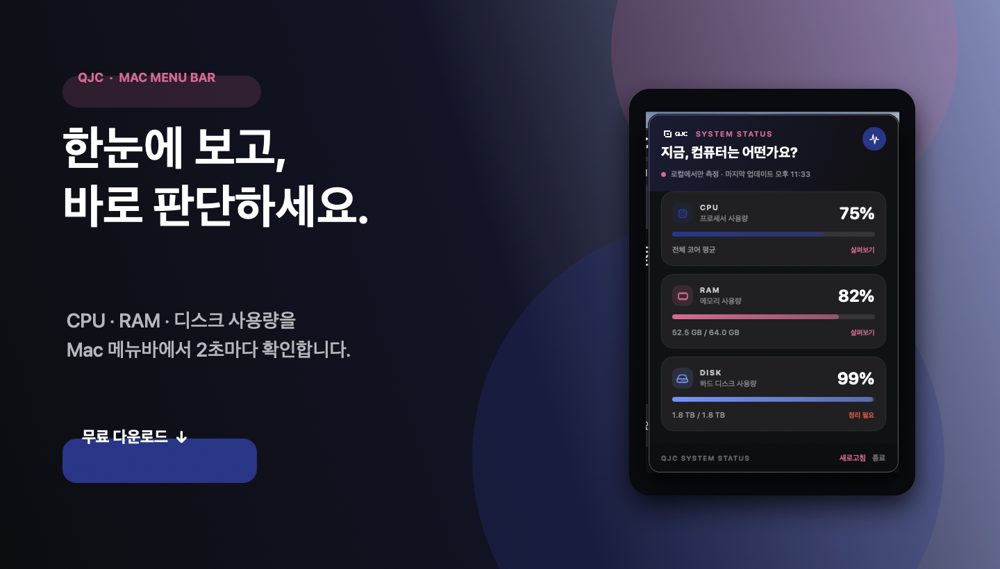
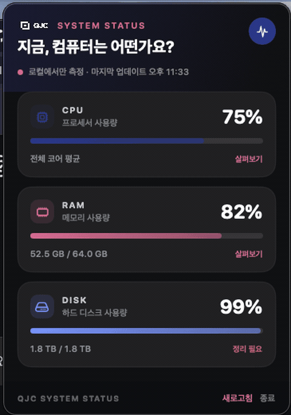
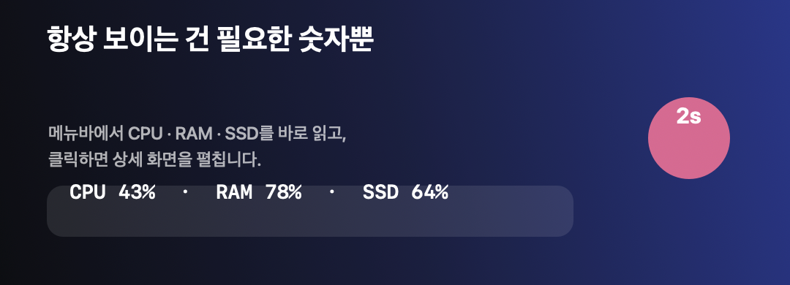
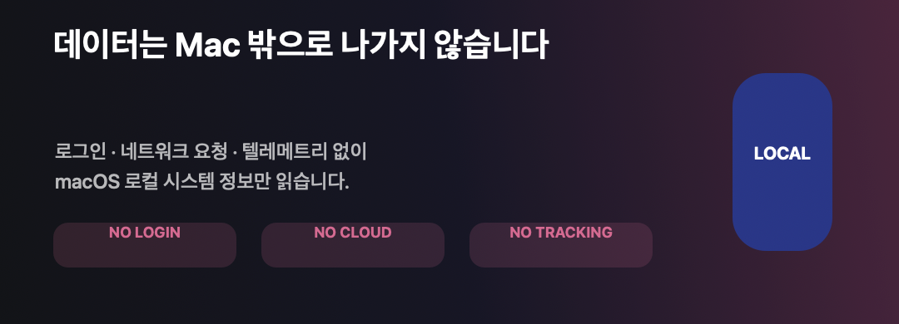
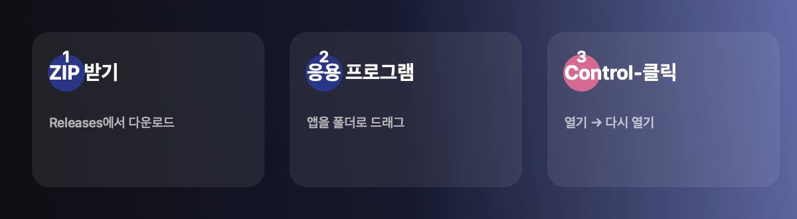

<div align="center">

# QJC System Status

### 한눈에 보고, 바로 판단하는 Mac 메뉴바 시스템 모니터

[](https://github.com/qjc-office/qjc-system-status/releases/latest)
[](https://github.com/qjc-office/qjc-system-status/releases/latest)
[](#설치하기-개발-지식-필요-없음)

CPU · RAM · 디스크 사용량을 메뉴바에서 2초마다 보여 줍니다.<br>
로그인도, 설정도, 데이터 전송도 없습니다.

### [설치 파일 바로 받기 (.zip)](https://github.com/qjc-office/qjc-system-status/releases/download/v1.0.1/QJC-System-Status-1.0.1.zip)

<sub>[버전 정보와 릴리스 노트 보기](https://github.com/qjc-office/qjc-system-status/releases/latest)</sub>

</div>



## 어떤 앱인가요?

Mac이 느려졌을 때 활동 모니터를 찾아 열 필요가 없습니다. 메뉴바에 보이는 `CPU · RAM · SSD` 숫자를 확인하고, 클릭하면 세부 사용량과 상태를 바로 볼 수 있습니다.

| 한눈에 확인 | Mac 안에서만 측정 | 자동 언어 설정 |
|---|---|---|
| CPU·메모리·저장 공간을 2초마다 갱신 | 로그인·클라우드·추적 기능 없음 | Mac의 기본 언어를 자동 감지 |

## 실제 화면

<p align="center">
  
  <br>
  <sub>실제 앱 화면으로 만든 4초 미리보기 · <a href="docs/assets/readme-demo.mp4">영상 파일로 보기</a></sub>
</p>

<table>
  <tr>
    <td width="50%"></td>
    <td width="50%"></td>
  </tr>
  <tr>
    <td><strong>필요한 숫자만 항상 표시</strong><br>메뉴바에서 CPU·RAM·SSD를 바로 읽습니다.</td>
    <td><strong>데이터는 Mac 안에만</strong><br>외부 서버로 사용량을 전송하지 않습니다.</td>
  </tr>
</table>

## 설치하기: 개발 지식 필요 없음

> 현재 다운로드 파일은 **Apple Silicon Mac(M1·M2·M3·M4 이상)** 전용이며 macOS 13 이상에서 동작합니다. 내 Mac의 칩은 화면 왼쪽 위 ` → 이 Mac에 관하여`에서 확인할 수 있습니다.



### 1. 앱 받기

아래 링크를 누르면 `QJC-System-Status-1.0.1.zip` 다운로드가 바로 시작됩니다.

### [QJC System Status 설치 파일 다운로드](https://github.com/qjc-office/qjc-system-status/releases/download/v1.0.1/QJC-System-Status-1.0.1.zip)

### 2. 압축 풀기

Finder의 `다운로드` 폴더에서 받은 zip 파일을 더블클릭합니다. `QJC System Status.app`이 나타납니다.

### 3. 응용 프로그램으로 옮기기

`QJC System Status.app`을 Finder 왼쪽의 `응용 프로그램` 폴더로 드래그합니다.

### 4. 처음 한 번 열기

앱에 개발자 공증이 아직 없어 일반적인 더블클릭은 macOS가 차단할 수 있습니다.

1. `응용 프로그램`에서 `QJC System Status`를 **Control-클릭 또는 마우스 오른쪽 클릭**합니다.
2. 메뉴에서 `열기`를 선택합니다.
3. 다시 나타나는 창에서 `열기`를 누릅니다.

그래도 열리지 않으면 `시스템 설정 → 개인정보 보호 및 보안`으로 이동해 아래쪽의 `확인 없이 열기`를 누르세요. 이 과정은 처음 한 번만 필요합니다.

### 5. 메뉴바에서 확인하기

실행되면 화면 위 메뉴바에 `CPU · RAM · SSD`가 나타납니다. 숫자를 클릭하면 상세 화면이 열리고, `새로고침`은 즉시 다시 측정하며 `종료`는 앱을 완전히 닫습니다.

## 상태를 읽는 방법

| 상태 | 의미 | 해볼 일 |
|---|---|---|
| 안정적 | 현재 사용량이 여유롭습니다 | 그대로 사용하세요 |
| 살펴보기 | 사용량이 조금 높습니다 | 사용하지 않는 앱을 정리하세요 |
| 정리 필요 | 사용량이 85% 이상입니다 | 큰 앱·파일을 우선 확인하세요 |
| 읽을 수 없음 | macOS에서 순간적으로 값을 받지 못했습니다 | 잠시 기다리거나 새로고침하세요 |

## 주요 기능

- 메뉴바에 CPU·RAM·SSD 사용률 상시 표시
- CPU 사용률과 메모리·디스크의 실제 사용량/전체 용량 표시
- 2초 자동 갱신과 수동 새로고침
- 한국어·영어·일본어·중국어 간체/번체·스페인어·프랑스어·독일어 지원
- 그 밖의 시스템 언어는 영어로 안전하게 표시
- 측정값을 읽지 못해도 앱이 종료되지 않는 `Unavailable` fallback
- Dock 아이콘 없이 메뉴바에서 조용히 실행
- 네트워크 요청·로그인·광고·분석 수집 없음

## 자주 묻는 질문

<details>
<summary><strong>앱을 실행했는데 Dock에 보이지 않아요.</strong></summary>

정상입니다. QJC System Status는 메뉴바 전용 앱이라 Dock 아이콘이 없습니다. 화면 위쪽의 `CPU · RAM · SSD` 숫자를 찾아보세요.
</details>

<details>
<summary><strong>“Apple에서 악성 소프트웨어가 없는지 확인할 수 없습니다”라고 나와요.</strong></summary>

현재 릴리스에 Apple 개발자 공증이 없어서 나타나는 안내입니다. `응용 프로그램` 폴더의 앱을 Control-클릭하고 `열기`를 선택하세요. 위의 [처음 한 번 열기](#4-처음-한-번-열기)에 화면 경로를 적어 두었습니다.
</details>

<details>
<summary><strong>로그인이나 인터넷 연결이 필요한가요?</strong></summary>

필요하지 않습니다. CPU tick, VM statistics, 파일 시스템 속성을 Mac 안에서만 읽으며 네트워크로 전송하지 않습니다.
</details>

<details>
<summary><strong>Mac을 켤 때 자동 실행되나요?</strong></summary>

현재 버전은 자동 시작을 직접 등록하지 않습니다. 원하면 `시스템 설정 → 일반 → 로그인 항목`에서 QJC System Status를 추가할 수 있습니다.
</details>

<details>
<summary><strong>Intel Mac에서도 사용할 수 있나요?</strong></summary>

현재 공개 zip은 Apple Silicon 전용입니다. Intel Mac 사용자는 아래 개발자 섹션의 소스 빌드를 이용해야 합니다. 추후 Universal Binary 릴리스를 제공할 예정입니다.
</details>

## 개인정보 보호


QJC System Status는 CPU tick, VM statistics, 파일 시스템 속성만 읽습니다. 계정, 브라우저 기록, 파일 내용은 읽지 않으며 네트워크 요청·텔레메트리·개인정보 저장을 구현하지 않았습니다.

## 개발자를 위한 소스 빌드

일반 사용자는 이 섹션을 따라 할 필요가 없습니다. Swift 6 toolchain이 설치된 개발 환경에서는 아래 명령으로 빌드할 수 있습니다.

```bash
git clone https://github.com/qjc-office/qjc-system-status.git
cd qjc-system-status
zsh scripts/package_app.sh
open "dist/QJC System Status.app"
```

검증 명령:

```bash
swift run QJCSystemStatus --self-test
swift build -c release
```

```text
Sources/QJCSystemStatus/App.swift  수집기 · 상태 모델 · SwiftUI · 다국어
Resources/Info.plist               메뉴바 앱 메타데이터
scripts/package_app.sh             release binary → .app 패키징
docs/specs/                        기능 명세와 검증 기록
```

## 피드백과 기여

문제가 생기거나 원하는 기능이 있다면 [GitHub Issues](https://github.com/qjc-office/qjc-system-status/issues)에 남겨 주세요. 잘 사용하고 계시다면 저장소에 Star를 눌러 주시면 다음 개선에 큰 도움이 됩니다.

## License

Copyright © 2026 QJC. All rights reserved.
