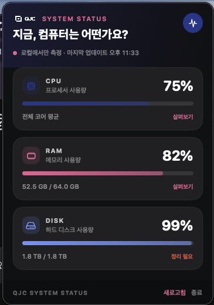

# QJC System Status

> 한눈에 보고, 바로 판단하는 Mac 메뉴바 시스템 모니터

[](https://github.com/qjc-office/qjc-system-status/releases/latest)
[](https://github.com/qjc-office/qjc-system-status/releases/latest)

QJC System Status는 CPU·RAM·디스크 사용량을 메뉴바에서 조용히 확인하는 macOS 앱입니다. [최신 릴리스 다운로드](https://github.com/qjc-office/qjc-system-status/releases/latest) 또는 소스에서 직접 빌드할 수 있습니다.

CPU·RAM·SSD 사용량을 메뉴바에서 2초마다 갱신합니다. 값은 Mac 안에서만 읽고 외부로 전송하지 않습니다. QJC의 검정·흰색 고대비와 핑크·딥 인디고 포인트를 작은 팝오버에 담았습니다.



## 주요 기능

- 메뉴바에 `CPU · RAM · SSD` 사용률을 항상 표시
- 클릭하면 실제 사용량/전체 용량, 진행 바, 상태 문구(`Stable` / `Watch` / `Needs attention`) 제공
- PC의 시스템 언어를 자동 감지해 한국어·영어·일본어·중국어 간체/번체·스페인어·프랑스어·독일어로 표시
- 지원 언어가 추가되지 않은 경우 영어로 안전하게 fallback
- 디스크 API가 값을 반환하지 않는 순간에도 크래시하지 않고 `Unavailable` 표시
- macOS `LSUIElement`로 Dock 아이콘 없이 메뉴바에서 조용히 실행
- 외부 API, 로그인, 분석 수집 없이 로컬 시스템 API만 사용

## 설치 및 실행

요구 사항: macOS 13 이상, Swift 6 toolchain

### 릴리스 설치

1. [Releases](https://github.com/qjc-office/qjc-system-status/releases/latest)에서 `QJC-System-Status-1.0.0.zip`을 받습니다.
2. 압축을 풀고 `QJC System Status.app`을 `Applications`로 옮깁니다.
3. 앱을 실행한 뒤 메뉴바의 `CPU · RAM · SSD` 표시를 클릭합니다.

현재 릴리스는 개발자 서명 없이 배포한 zip입니다. macOS가 처음 실행을 막으면 앱을 Control-click한 뒤 `열기`를 선택하세요.

### 소스에서 빌드

```bash
zsh scripts/package_app.sh
open "dist/QJC System Status.app"
```

메뉴바의 `CPU · RAM · SSD` 표시를 누르면 상세 화면이 열립니다. `Refresh`는 즉시 재측정하고 `Quit`은 앱을 종료합니다.

표시 언어는 macOS의 기본 언어 설정을 자동 감지합니다. 현재 한국어·영어·일본어·중국어 간체/번체·스페인어·프랑스어·독일어를 제공하며, 번역 리소스가 없는 언어는 영어로 안전하게 표시합니다.

## 개발 및 검증

```bash
# 계약 테스트: clamp·threshold·용량 포맷·디스크 fallback·언어 감지
swift run QJCSystemStatus --self-test

# 릴리스 빌드
swift build -c release

# 서명된 .app 번들 생성
zsh scripts/package_app.sh
```

## 구조

```text
Sources/QJCSystemStatus/App.swift  # 수집기, 상태 모델, SwiftUI 팝오버, localization
Sources/QJCSystemStatus/Resources/ # QJC V07 로고 리소스
Resources/Info.plist                # LSUIElement·앱 메타데이터
scripts/package_app.sh              # release binary → .app 패키징
docs/specs/                         # 기능 명세
```

## Privacy

CPU tick, VM statistics, 파일 시스템 속성만 읽습니다. 네트워크 요청·텔레메트리·개인정보 저장은 구현하지 않았습니다.

## License

Copyright © 2026 QJC. All rights reserved.
